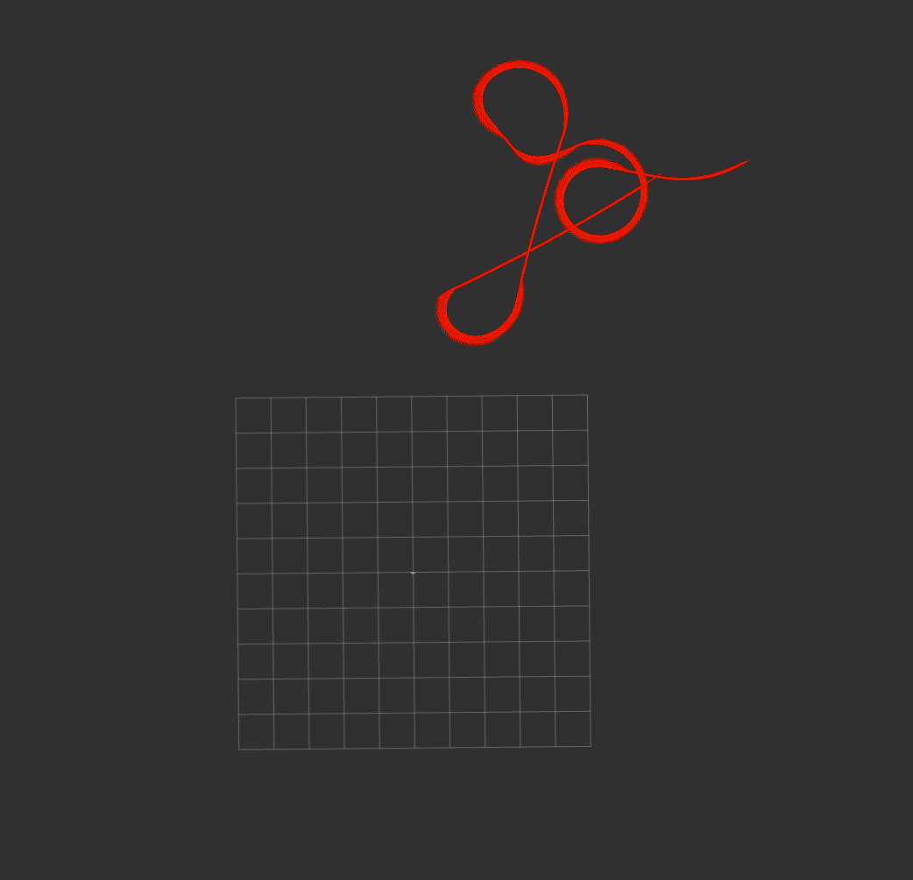

# Mobile Robot Odometry and Error Analysis

A ROS 2 academic robotics project implementing planar odometry for the AgileX Bunker mobile robot and comparing its estimated trajectory with a GPS reference from recorded data.

## Features

- C++ odometer integrating the driver's linear and angular velocities using second-order Runge-Kutta (midpoint integration).
- Odometry publication on `/project_odom` and TF broadcasting from `odom` to `base_link2`.
- A `/reset` service to return the estimated pose to the origin.
- A TF error node publishing positional difference, elapsed time, and accumulated distance at 20 Hz.
- RViz configuration and recorded visualization screenshots.

## Technologies

C++, ROS 2, rclcpp, TF2, RViz2, rosbag2, CMake/ament, Python launch files.

## Repository structure

```text
first_project/   Odometry and error-analysis nodes, launch file, RViz configuration
bunker_msgs/     Supporting Bunker ROS message definitions
screenshot/      RViz screenshots from the original project
```

## Build

Use a Linux environment with ROS 2 and colcon installed. Source your ROS installation first, then place both packages in a workspace:

```bash
mkdir -p ~/ros2_ws/src
cp -r first_project bunker_msgs ~/ros2_ws/src/
cd ~/ros2_ws
rosdep install --from-paths src --ignore-src -r -y
colcon build --packages-select bunker_msgs first_project
source install/setup.bash
```

## Run

In one terminal, replay a compatible recording using its simulation clock:

```bash
ros2 bag play /path/to/fixed_bag --clock
```

In another terminal, source the workspace and launch the nodes and visualization:

```bash
source ~/ros2_ws/install/setup.bash
ros2 launch first_project first_project.launch.py
```

Reset the estimated pose with:

```bash
ros2 service call /reset std_srvs/srv/Empty
```

The recording must supply `/bunker_status` and reference TF data for `odom` to `base_link`. Original bag files are not included in this repository.

## Interpretation and validation

The estimated pose starts at `(0, 0, 0)`; the GPS reference may start elsewhere. The reported Euclidean difference therefore includes any initial reference offset and should not be interpreted as aligned odometry drift without first accounting for that offset. The node uses driver-provided velocities rather than calculating wheel kinematics from raw motor RPM.

The screenshots document original visualization runs. This repository was prepared from the archived project; it has not been rebuilt or runtime-tested in the Windows publishing environment. No quantitative accuracy claim is made.

## Example visualization



## Academic context

Academic robotics coursework. Supporting message definitions are included as supplied with the archived project. The repository excludes submission identifiers, course handouts, and recorded datasets.
